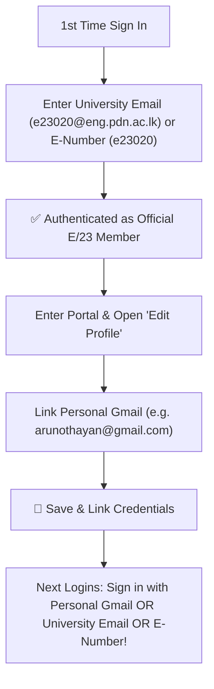

# E/23 Batch Portal — Faculty of Engineering, University of Peradeniya 🎓🇱🇰

Official batch portal for **E/23 Batch, Faculty of Engineering, University of Peradeniya (UoP)**.

---

## 🚀 Live Preview
Your development server is running at:
**[http://localhost:5173](http://localhost:5173)**

---

## 📸 Connected Google Drive Albums

### Year 1 Folders
1. **Batch Trip**: [Google Drive Folder](https://drive.google.com/drive/folders/1anuE8pblh0Ty0IPMqYvQAOEniX5oweAo?usp=drive_link)
2. **Birthdays**: [Google Drive Folder](https://drive.google.com/drive/folders/1zTG5xGAn8e4RH46Q-B7XemQ6NxlNMCp6?usp=drive_link)
3. **Kovil**: [Google Drive Folder](https://drive.google.com/drive/folders/1FiVeDdYtU_l42YnGPNIk9mJjSMI-skwn?usp=drive_link)
4. **Random**: [Google Drive Folder](https://drive.google.com/drive/folders/1bV0RCQNd5wayFmPlngVkCBNy82_gIh7J?usp=drive_link)

### Year 2 Folders
5. **Batch Trip 3.0**: [Google Drive Folder](https://drive.google.com/drive/folders/1DINr6lLjXd2jYDYACZm7OdjbSH-YJ31P?usp=drive_link)
6. **Birthdays**: [Google Drive Folder](https://drive.google.com/drive/folders/13QhpHUr7Sz_dix9dWAgHOIOBRox2VoYB?usp=drive_link)
7. **Kovil**: [Google Drive Folder](https://drive.google.com/drive/folders/1a7Kclfojtkie7yfyFXYkZMjAXDLtTnKl?usp=drive_link)
8. **Matches**: [Google Drive Folder](https://drive.google.com/drive/folders/1iVfIE4AltlsSoOpySR5Yy9bruPm7mRlH?usp=drive_link)
9. **Random**: [Google Drive Folder](https://drive.google.com/drive/folders/1XniK-i8qAPcyW9KfF_RavJxCPLSjZ1Re?usp=drive_link)

---

## 🔒 Security: "Only People with Access Can View" Settings

**Yes!** Google Drive's native security model guarantees that only authorized users can view the contents:

1. **How Google Drive Enforces Access**:
   - In Google Drive, each folder has its General Access set to **"Restricted"**.
   - Under "Add people and groups", you add your batch email group (or individual classmate emails `@eng.pdn.ac.lk` or personal Gmails).
   - When a user opens any folder (either by clicking "Open in Drive" or using the in-app "Browse in App" modal), Google checks their authenticated Google account.
   - **If they are in the allowed list:** They can view/download all photos.
   - **If an outsider attempts access:** Google blocks them with *"Access Denied — You need access"*.

---

## 🔐 Authentication & Personal Email Transfer Flow

### 1. First-Time Verification
- Initial sign-in is secured using the student's official **Faculty of Engineering email** (`e23xxx@eng.pdn.ac.lk`) or their **E-Number** (`E/23/xxx` or `e23xxx`).
- This verifies that only genuine enrolled E/23 engineers can claim their profile.

### 2. Linking Personal Email for Future Sign-Ins
- Once inside the portal, members can click **Edit Profile** &rarr; **Sign-In Credentials & Personal Email Link**.
- Enter any personal email (e.g. personal Google/Gmail: `yourname@gmail.com`).
- Once saved, members can log in using either their:
  - **Personal Email** (`yourname@gmail.com`)
  - **University Email** (`e23xxx@eng.pdn.ac.lk`)
  - **E-Number** (`e23xxx`)

---

## 🏛️ Batch Highlights
- **Inception Date**: **October 10, 2024** (Celebrated the 2-Year Milestone!).
- **Progress**: **4 Semesters Completed** (Halfway Milestone: 50% Degree Progress).
- **Institution**: Faculty of Engineering, University of Peradeniya.
- **Email Domain**: `@eng.pdn.ac.lk`.
- **Roster**: 32 E/23 batch members with E-Numbers.
